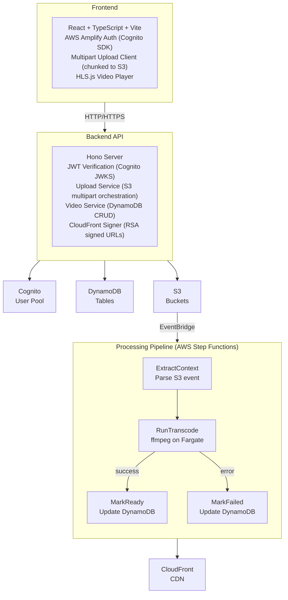
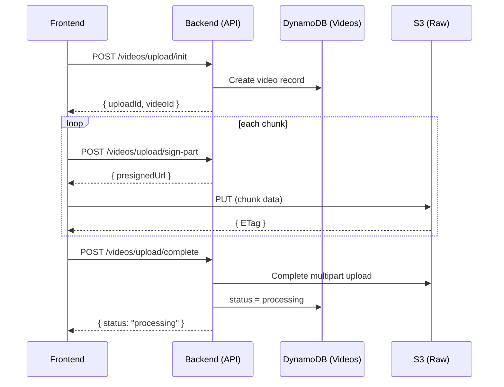
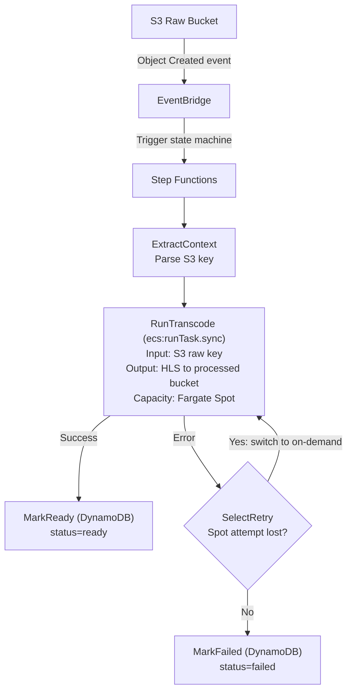
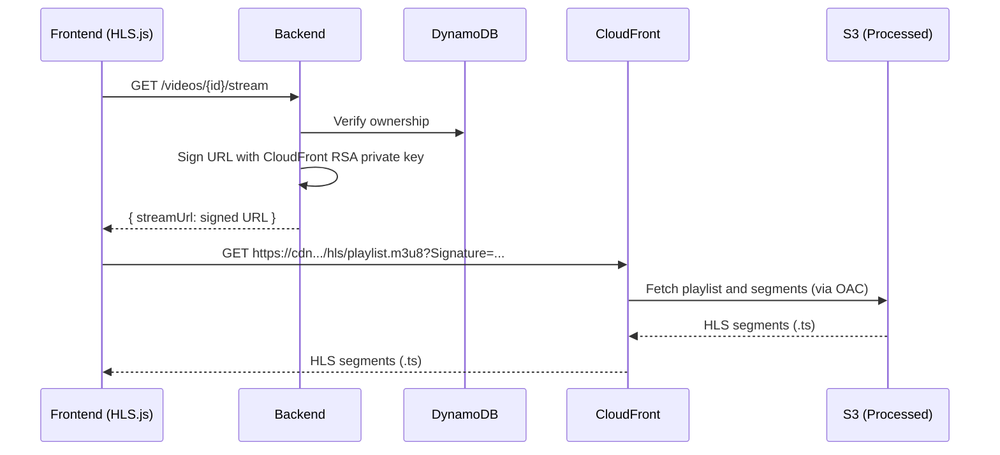
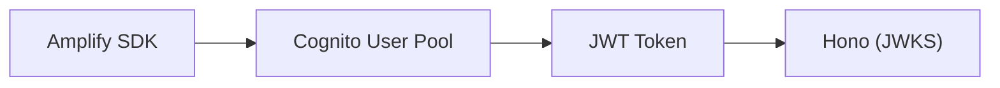

# CloudCast Architecture

> A secure video hosting platform with authenticated uploads and protected HLS streaming.

## Table of Contents

- [Overview](#overview)
- [System Architecture](#system-architecture)
- [Infrastructure Components](#infrastructure-components)
- [Data Flow](#data-flow)
- [Directory Structure](#directory-structure)
- [API Reference](#api-reference)
- [Database Schema](#database-schema)
- [Security Model](#security-model)

---

## Overview

CloudCast is a serverless-style video hosting platform that enables:

- **Authenticated multipart uploads** for large video files (up to 20GB)
- **Automated video transcoding** to HLS format with ffmpeg on AWS Fargate Spot
- **Secure playback** using CloudFront signed URLs

### Tech Stack

| Layer          | Technology                                      |
|----------------|------------------------------------------------|
| Frontend       | React 19, TypeScript, Vite, Tailwind CSS, hls.js |
| Backend API    | Hono (TypeScript), AWS SDK v3                   |
| Authentication | AWS Cognito (User Pools) + AWS Amplify SDK      |
| Storage        | Amazon S3 (raw + processed buckets)             |
| Database       | Amazon DynamoDB                                 |
| CDN            | Amazon CloudFront (with signed URLs)            |
| Transcoding    | ffmpeg (libx264) on ECS Fargate Spot            |
| Orchestration  | AWS Step Functions                              |
| IaC            | AWS SAM (Serverless Application Model)          |

---

## System Architecture



---

## Infrastructure Components

### AWS Resources (Defined in SAM Template)

| Resource                  | Type                            | Purpose                                      |
|---------------------------|--------------------------------|----------------------------------------------|
| `UserPool`                | Cognito User Pool              | User authentication and identity             |
| `UserPoolClient`          | Cognito User Pool Client       | Frontend auth integration                    |
| `RawUploadsBucket`        | S3 Bucket                      | Stores original uploaded video files         |
| `ProcessedVideosBucket`   | S3 Bucket                      | Stores transcoded HLS video segments         |
| `UsersTable`              | DynamoDB Table                 | User metadata storage                        |
| `VideosTable`             | DynamoDB Table                 | Video metadata and processing status         |
| `TranscoderRepository`    | ECR Repository                 | Holds the ffmpeg transcoder image            |
| `TranscoderCluster`       | ECS Cluster                    | Fargate and Fargate Spot capacity            |
| `TranscoderTaskDefinition`| ECS Task Definition            | Transcode task size, image, and roles        |
| `TranscoderTaskRole`      | IAM Role                       | Read raw bucket, write processed bucket      |
| `TranscoderVpc`           | VPC (two public subnets)       | Outbound-only network for transcode tasks    |
| `ProcessingStateMachine`  | Step Functions State Machine   | Orchestrates video processing workflow       |
| `CloudFrontOAC`           | CloudFront Origin Access Control| Secures S3 access to CloudFront only        |
| `CloudFrontDistribution`  | CloudFront Distribution        | CDN for secure video delivery                |

### S3 Bucket Structure

```
cloudcast-raw-{env}/
└── {user_id}/
    └── {video_id}/
        └── raw/
            └── {original_filename}

cloudcast-processed-{env}/
└── {user_id}/
    └── {video_id}/
        └── hls/
            ├── {stem}.m3u8          # master playlist
            ├── 1080p/index.m3u8     # one directory per rendition
            ├── 1080p/segment_*.ts
            └── audio/index.m3u8     # shared AAC track
```

---

## Data Flow

### 1. Upload Flow (Multipart)



**Sequence:**

1. **Initiate** – Frontend requests upload session → Backend creates S3 multipart upload + DynamoDB record
2. **Sign Parts** – For each 10MB chunk, frontend requests presigned URL → uploads directly to S3
3. **Complete** – Frontend sends part ETags → Backend completes S3 multipart upload, marks status as `processing`

### 2. Processing Flow (Step Functions)



**Transcoder Configuration (`transcoder/`):**

- **Input:** Original video from raw bucket
- **Output:** HLS playlist (`.m3u8`) + segments (`.ts`) to processed bucket
- **Ladder:** fixed rungs at 720p, 1080p, 1440p, and 2160p (bitrate caps 2.8, 5, 9, and 16 Mb/s). The task probes the source with ffprobe and encodes every rung up to the first one the source fits inside; that top rung keeps the source's own resolution, so nothing is upscaled and a 1920x800 film tops out at 1920x800.
- **Settings:** H.264 (libx264, `medium` preset, CRF 21 with a per-rung bitrate cap), 4-second segments with keyframes aligned across renditions, first audio track as AAC stereo at 128 kb/s in a shared audio group. All renditions are encoded in one ffmpeg run.
- **Capacity:** 16 vCPU / 32 GB Fargate task with 100 GB of ephemeral storage (`TranscoderVcpu` parameter). The first attempt runs on Fargate Spot; if it is interrupted or Spot capacity is unavailable, the workflow retries once on on-demand Fargate. A task is stopped after 12 hours.
- **Not handled:** HDR sources are converted to 8-bit without tone mapping, and only the first audio track is kept; subtitles are dropped.

### 3. Playback Flow (Secure Streaming)



**Security:**

- CloudFront validates signed URL (expiration + signature)
- Origin Access Control restricts S3 access to CloudFront only
- Signed URLs expire after configurable TTL (default: 60 minutes)

---

## Directory Structure

```
cloudcast/
├── docs/
│   ├── DESIGN.md          # Product design document
│   └── ARCHITECTURE.md    # This file
│
├── backend/               # TypeScript Hono application
│   ├── package.json       # Backend dependencies and commands
│   ├── scripts/build.mjs  # Self-contained Lambda esbuild bundle
│   ├── test/              # Vitest API, auth, AWS, signing, and workflow tests
│   └── src/
│       ├── app.ts         # Injected app factory, error handling
│       ├── docs.ts        # OpenAPI, Swagger UI, and ReDoc routes
│       ├── logger.ts      # Structured JSON logging
│       ├── server.ts      # Node.js local entry point (PORT, default 8000)
│       ├── lambda.ts      # Cached official Hono Lambda adapter
│       ├── container.ts   # Client/service dependency wiring
│       ├── auth.ts        # Cognito JWT verification (jose)
│       ├── aws.ts         # AWS SDK v3 client factories
│       ├── config.ts      # Zod settings (environment variables)
│       ├── middleware/    # Cognito auth, JSON body, and CORS middleware
│       ├── routes/        # OpenAPI route definitions and handlers
│       └── services/      # Upload, video repository, CloudFront signing
│
├── packages/contracts/    # Shared Zod API schemas and TypeScript types
├── package.json           # Workspace development, checks, and SAM build
├── pnpm-workspace.yaml    # Frontend, backend, and contracts workspace
├── pnpm-lock.yaml         # Single dependency lockfile
│
├── frontend/              # React SPA
│   ├── package.json      # pnpm workspace dependencies
│   ├── vite.config.ts    # Vite build configuration
│   ├── test/             # Vitest tests for lib/, utils/, and gesture helpers
│   └── src/
│       ├── main.tsx      # App bootstrap + Amplify init
│       ├── amplify.ts    # AWS Amplify configuration
│       ├── App.tsx       # Main component (auth, upload, player)
│       └── index.css     # Tailwind CSS entry
│
├── template.yaml          # CloudCast SAM full-stack template
├── samconfig.toml         # SAM deployment configuration
├── scripts/               # Node SAM/CloudFront deployment tooling
└── tasks/                 # Supporting assets for SAM
    └── workflow.asl.json # Step Functions definition (ASL + JSONata)
```

---

## API Reference

### Base URL

```
http://localhost:8000  (development)
https://{api-id}.execute-api.{region}.amazonaws.com/{env}/  (SAM)
```

### Authentication

All `/videos/*` endpoints require:

```
Authorization: Bearer <Cognito ID Token>
```

### Endpoints

| Method | Path                        | Description                          |
|--------|----------------------------|--------------------------------------|
| GET    | `/health`                  | Health check                         |
| POST   | `/videos/upload/init`      | Start multipart upload session       |
| POST   | `/videos/upload/sign-part` | Get presigned URL for chunk upload   |
| POST   | `/videos/upload/complete`  | Finalize multipart upload            |
| GET    | `/videos`                  | One page of the user's videos (filter, search, order) |
| GET    | `/videos/summary`          | Library counts and storage used      |
| GET    | `/videos/{video_id}`       | One video                            |
| PATCH  | `/videos/{video_id}`       | Rename or favorite a video           |
| DELETE | `/videos/{video_id}`       | Delete a video and its media         |
| GET    | `/videos/{video_id}/stream`| Get signed streaming URL             |

### Request/Response Schemas

**POST /videos/upload/init**
```json
// Request
{ "filename": "demo.mp4", "contentType": "video/mp4", "title": "My Video" }

// Response
{ "uploadId": "abc123", "videoId": "uuid-v4" }
```

**POST /videos/upload/sign-part**
```json
// Request
{ "videoId": "uuid", "uploadId": "abc123", "partNumber": 1 }

// Response
{ "presignedUrl": "https://s3...?X-Amz-Signature=..." }
```

**POST /videos/upload/complete**
```json
// Request
{ "videoId": "uuid", "uploadId": "abc123", "parts": [{ "etag": "...", "partNumber": 1 }] }

// Response
{ "status": "processing" }
```

**GET /videos**

Query parameters (all optional): `limit` (1–100, default 24), `cursor` (the previous page's
`nextCursor`), `q` (case-insensitive title search), `filter` (`all`, `favorites`, `in-progress`,
`ready`), `order` (`newest`, `oldest`).

```json
// Response
{
  "items": [
    {
      "id": "uuid",
      "title": "My Video",
      "status": "ready",
      "createdAt": 1700000000,
      "s3KeyHls": "user_id/video_id/hls/playlist.m3u8"
    }
  ],
  "nextCursor": "eyJ1c2VyX2lkIjoi..." // null on the last page
}
```

Pages are read from `UserCreatedIndex`, so a page costs only the items on it. Filters and search are
DynamoDB filter expressions on that query. If the index is not deployed yet, the API sorts and
pages in memory instead (and logs a warning).

**GET /videos/summary**
```json
// Response
{ "total": 31, "favorites": 6, "inProgress": 1, "storageUsedBytes": 5740000000, "storageQuotaBytes": 21474836480 }
```

**GET /videos/{video_id}/stream**
```json
// Response
{ "streamUrl": "https://cdn.../hls/playlist.m3u8?Signature=..." }
```

---

## Database Schema

### DynamoDB Tables

#### Users Table (`CloudCast-Users-{env}`)

| Attribute    | Type   | Key Type      |
|-------------|--------|---------------|
| `id`        | String | Partition Key |
| `email`     | String |               |
| `created_at`| Number |               |

#### Videos Table (`CloudCast-Videos-{env}`)

| Attribute     | Type   | Key Type      |
|--------------|--------|---------------|
| `user_id`    | String | Partition Key |
| `id`         | String | Sort Key      |
| `title`      | String |               |
| `s3_key_raw` | String |               |
| `s3_key_hls` | String |               |
| `status`     | String |               |
| `title_search` | String | lower-cased title for search |
| `upload_id`  | String | (temporary)   |
| `created_at` | Number |               |

**Global Secondary Indexes:**
- `VideoIdIndex` – Partition Key: `id` (enables lookup by video ID without knowing user)
- `UserCreatedIndex` – Partition Key: `user_id`, Sort Key: `created_at` (newest-first library pages)

**Status Values:**
- `uploading` – Multipart upload in progress
- `processing` – Transcode task running
- `ready` – HLS available for streaming
- `failed` – Processing error occurred

---

## Security Model

### Authentication Layer



- Frontend uses AWS Amplify to authenticate with Cognito
- Backend validates JWT tokens using Cognito JWKS endpoint
- User identity (`sub` claim) used for resource ownership

### Content Protection

| Asset               | Protection Method                          |
|--------------------|-------------------------------------------|
| Raw uploads (S3)   | Presigned URLs (part-level, time-limited) |
| Processed videos   | CloudFront signed URLs + OAC              |
| S3 buckets         | Block public access enabled               |

### IAM Permissions

- **Transcoder Task Role:** Read from raw bucket, write to processed bucket
- **Step Functions Role:** ECS RunTask/StopTask/DescribeTasks on the transcoder, DynamoDB UpdateItem, EventBridge
- **CloudFront OAC:** GetObject on processed bucket only

---

## Environment Configuration

### Backend Environment Variables

| Variable                      | Description                              |
|------------------------------|------------------------------------------|
| `AWS_REGION`                 | AWS region (default: us-east-1)          |
| `RAW_UPLOADS_BUCKET`         | S3 bucket for raw uploads                |
| `PROCESSED_VIDEOS_BUCKET`    | S3 bucket for HLS output                 |
| `VIDEOS_TABLE`               | DynamoDB table name                      |
| `USERS_TABLE`                | DynamoDB table name                      |
| `COGNITO_USER_POOL_ID`       | Cognito User Pool ID                     |
| `COGNITO_CLIENT_ID`          | Cognito App Client ID                    |
| `COGNITO_REGION`             | Cognito region                           |
| `CLOUDFRONT_DOMAIN`          | CloudFront distribution domain           |
| `CLOUDFRONT_KEY_ID`          | CloudFront key pair ID                   |
| `CLOUDFRONT_PRIVATE_KEY`     | RSA private key (inline or path)         |

### Frontend Environment Variables

| Variable                    | Description                |
|----------------------------|----------------------------|
| `VITE_API_BASE_URL`        | Backend API URL            |
| `VITE_COGNITO_REGION`      | Cognito region             |
| `VITE_COGNITO_USER_POOL_ID`| Cognito User Pool ID       |
| `VITE_COGNITO_CLIENT_ID`   | Cognito App Client ID      |

---

## Deployment

### Prerequisites

- AWS CLI configured with appropriate credentials
- AWS SAM CLI installed
- Docker (builds the transcoder image)
- Node.js 24 and pnpm 11.25.0

### Deploy Infrastructure

```bash
pnpm install --frozen-lockfile
pnpm deploy:stack --guided  # First time
pnpm deploy:stack           # Subsequent deploys
pnpm deploy:transcoder      # Build and push the ffmpeg image
pnpm deploy:frontend        # Publish frontend
# Or deploy the stack, transcoder image and frontend together:
pnpm run deploy
```

### Run Backend (Development)

```bash
AWS_PROFILE=personal pnpm dev:backend
```

### Run Frontend (Development)

```bash
pnpm dev:frontend
```

---

## Monitoring

- **Step Functions:** Execution history in AWS Console
- **Transcoder:** ffmpeg progress and errors in the `/cloudcast/{env}/transcoder` CloudWatch log group; task history in the ECS console
- **CloudWatch Logs:** Backend logs (if deployed to EC2/Lambda)
- **DynamoDB:** Video status field tracks processing state
