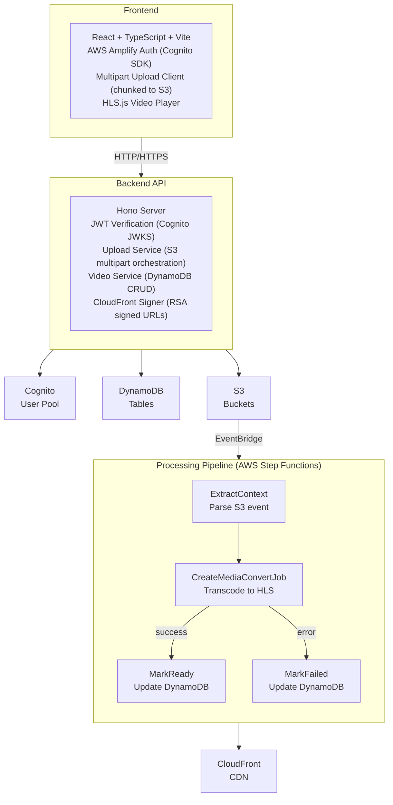
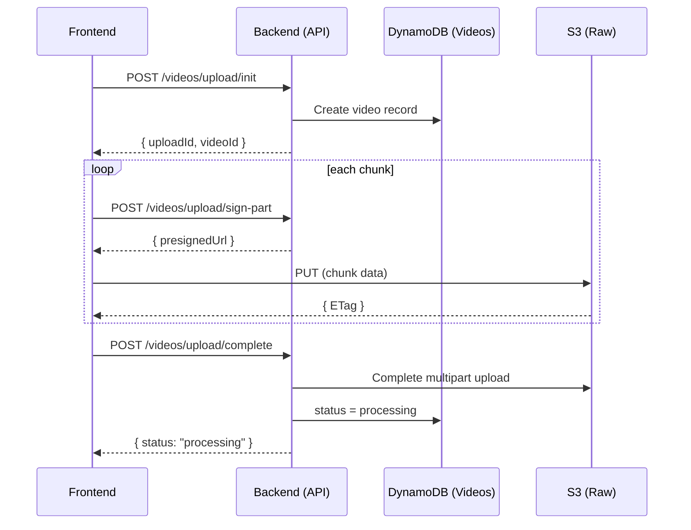
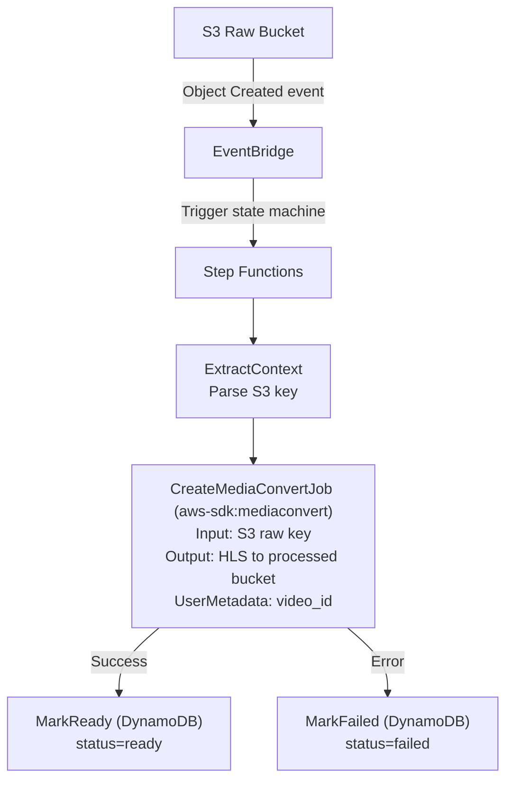
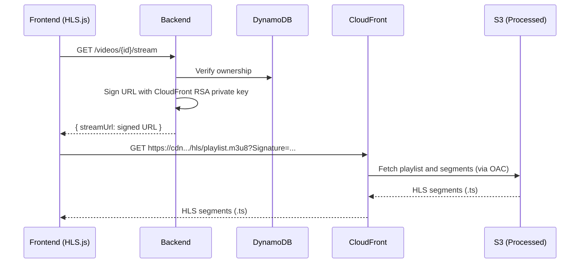
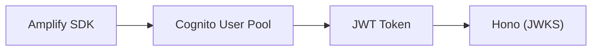

# CloudCast Architecture

> A secure video hosting platform with authenticated uploads and protected HLS streaming.

## Table of Contents

- [Overview](#overview)
- [System Architecture](#system-architecture)
- [Infrastructure Components](#infrastructure-components)
- [Data Flow](#data-flow)
- [Directory Structure](#directory-structure)
- [API Reference](#api-reference)
- [Database Schema](#database-schema)
- [Security Model](#security-model)

---

## Overview

CloudCast is a serverless-style video hosting platform that enables:

- **Authenticated multipart uploads** for large video files (up to 20GB)
- **Automated video transcoding** to HLS format via AWS MediaConvert
- **Secure playback** using CloudFront signed URLs

### Tech Stack

| Layer          | Technology                                      |
|----------------|------------------------------------------------|
| Frontend       | React 19, TypeScript, Vite, Tailwind CSS, hls.js |
| Backend API    | Hono (TypeScript), AWS SDK v3                   |
| Authentication | AWS Cognito (User Pools) + AWS Amplify SDK      |
| Storage        | Amazon S3 (raw + processed buckets)             |
| Database       | Amazon DynamoDB                                 |
| CDN            | Amazon CloudFront (with signed URLs)            |
| Transcoding    | AWS Elemental MediaConvert                      |
| Orchestration  | AWS Step Functions                              |
| IaC            | AWS SAM (Serverless Application Model)          |

---

## System Architecture



---

## Infrastructure Components

### AWS Resources (Defined in SAM Template)

| Resource                  | Type                            | Purpose                                      |
|---------------------------|--------------------------------|----------------------------------------------|
| `UserPool`                | Cognito User Pool              | User authentication and identity             |
| `UserPoolClient`          | Cognito User Pool Client       | Frontend auth integration                    |
| `RawUploadsBucket`        | S3 Bucket                      | Stores original uploaded video files         |
| `ProcessedVideosBucket`   | S3 Bucket                      | Stores transcoded HLS video segments         |
| `UsersTable`              | DynamoDB Table                 | User metadata storage                        |
| `VideosTable`             | DynamoDB Table                 | Video metadata and processing status         |
| `MediaConvertRole`        | IAM Role                       | Permissions for MediaConvert jobs            |
| `ProcessingStateMachine`  | Step Functions State Machine   | Orchestrates video processing workflow       |
| `CloudFrontOAC`           | CloudFront Origin Access Control| Secures S3 access to CloudFront only        |
| `CloudFrontDistribution`  | CloudFront Distribution        | CDN for secure video delivery                |

### S3 Bucket Structure

```
cloudcast-raw-{env}/
└── {user_id}/
    └── {video_id}/
        └── raw/
            └── {original_filename}

cloudcast-processed-{env}/
└── {user_id}/
    └── {video_id}/
        └── hls/
            ├── playlist.m3u8
            └── playlist_720p_*.ts
```

---

## Data Flow

### 1. Upload Flow (Multipart)



**Sequence:**

1. **Initiate** – Frontend requests upload session → Backend creates S3 multipart upload + DynamoDB record
2. **Sign Parts** – For each 10MB chunk, frontend requests presigned URL → uploads directly to S3
3. **Complete** – Frontend sends part ETags → Backend completes S3 multipart upload, marks status as `processing`

### 2. Processing Flow (Step Functions)



**MediaConvert Configuration:**

- **Input:** Original video from raw bucket
- **Output:** HLS playlist (`.m3u8`) + segments (`.ts`) to processed bucket
- **Settings:** H.264 Automated ABR capped at 4K (`3840x2160`), up to 6 renditions, 600 kb/s-20 Mb/s average ABR range, QVBR + multi-pass HQ, AAC stereo audio at 128 kb/s. The frontend records source dimensions at upload time; Step Functions uses them to keep sub-1080p sources source-native, require a 1080p top rendition for 1080p-or-higher sources, force a 1440p rendition for 2K-or-higher sources, and force a 2160p rendition for 4K sources.

### 3. Playback Flow (Secure Streaming)



**Security:**

- CloudFront validates signed URL (expiration + signature)
- Origin Access Control restricts S3 access to CloudFront only
- Signed URLs expire after configurable TTL (default: 60 minutes)

---

## Directory Structure

```
cloudcast/
├── docs/
│   ├── DESIGN.md          # Product design document
│   └── ARCHITECTURE.md    # This file
│
├── backend/               # TypeScript Hono application
│   ├── package.json       # Backend dependencies and commands
│   ├── scripts/build.mjs  # Self-contained Lambda esbuild bundle
│   ├── test/              # Vitest API, auth, AWS, signing, and workflow tests
│   └── src/
│       ├── app.ts         # Injected app factory and documentation
│       ├── server.ts      # Node.js local entry point (:8000)
│       ├── lambda.ts      # Cached official Hono Lambda adapter
│       ├── container.ts   # Client/service dependency wiring
│       ├── auth.ts        # Cognito JWT verification (jose)
│       ├── aws.ts         # AWS SDK v3 client factories
│       ├── config.ts      # Zod settings (environment variables)
│       ├── routes/        # OpenAPI routes and authorization
│       └── services/      # Upload, video repository, CloudFront signing
│
├── packages/contracts/    # Shared Zod API schemas and TypeScript types
├── package.json           # Workspace development, checks, and SAM build
├── pnpm-workspace.yaml    # Frontend, backend, and contracts workspace
├── pnpm-lock.yaml         # Single dependency lockfile
│
├── frontend/              # React SPA
│   ├── package.json      # pnpm workspace dependencies
│   ├── vite.config.ts    # Vite build configuration
│   └── src/
│       ├── main.tsx      # App bootstrap + Amplify init
│       ├── amplify.ts    # AWS Amplify configuration
│       ├── App.tsx       # Main component (auth, upload, player)
│       └── index.css     # Tailwind CSS entry
│
├── template.yaml          # CloudCast SAM full-stack template
├── samconfig.toml         # SAM deployment configuration
├── scripts/               # Node SAM/CloudFront deployment tooling
└── tasks/                 # Supporting assets for SAM
    └── workflow.asl.json # Step Functions definition (ASL + JSONata)
```

---

## API Reference

### Base URL

```
http://localhost:8000  (development)
https://{api-id}.execute-api.{region}.amazonaws.com/{env}/  (SAM)
```

### Authentication

All `/videos/*` endpoints require:

```
Authorization: Bearer <Cognito ID Token>
```

### Endpoints

| Method | Path                        | Description                          |
|--------|----------------------------|--------------------------------------|
| GET    | `/health`                  | Health check                         |
| POST   | `/videos/upload/init`      | Start multipart upload session       |
| POST   | `/videos/upload/sign-part` | Get presigned URL for chunk upload   |
| POST   | `/videos/upload/complete`  | Finalize multipart upload            |
| GET    | `/videos`                  | List user's videos                   |
| GET    | `/videos/{video_id}/stream`| Get signed streaming URL             |

### Request/Response Schemas

**POST /videos/upload/init**
```json
// Request
{ "filename": "demo.mp4", "contentType": "video/mp4", "title": "My Video" }

// Response
{ "uploadId": "abc123", "videoId": "uuid-v4" }
```

**POST /videos/upload/sign-part**
```json
// Request
{ "videoId": "uuid", "uploadId": "abc123", "partNumber": 1 }

// Response
{ "presignedUrl": "https://s3...?X-Amz-Signature=..." }
```

**POST /videos/upload/complete**
```json
// Request
{ "videoId": "uuid", "uploadId": "abc123", "parts": [{ "etag": "...", "partNumber": 1 }] }

// Response
{ "status": "processing" }
```

**GET /videos**
```json
// Response
{
  "items": [
    {
      "id": "uuid",
      "title": "My Video",
      "status": "ready",
      "createdAt": 1700000000,
      "s3KeyHls": "user_id/video_id/hls/playlist.m3u8"
    }
  ]
}
```

**GET /videos/{video_id}/stream**
```json
// Response
{ "streamUrl": "https://cdn.../hls/playlist.m3u8?Signature=..." }
```

---

## Database Schema

### DynamoDB Tables

#### Users Table (`CloudCast-Users-{env}`)

| Attribute    | Type   | Key Type      |
|-------------|--------|---------------|
| `id`        | String | Partition Key |
| `email`     | String |               |
| `created_at`| Number |               |

#### Videos Table (`CloudCast-Videos-{env}`)

| Attribute     | Type   | Key Type      |
|--------------|--------|---------------|
| `user_id`    | String | Partition Key |
| `id`         | String | Sort Key      |
| `title`      | String |               |
| `s3_key_raw` | String |               |
| `s3_key_hls` | String |               |
| `status`     | String |               |
| `upload_id`  | String | (temporary)   |
| `created_at` | Number |               |

**Global Secondary Index:** `VideoIdIndex`
- Partition Key: `id` (enables lookup by video ID without knowing user)

**Status Values:**
- `uploading` – Multipart upload in progress
- `processing` – MediaConvert job running
- `ready` – HLS available for streaming
- `failed` – Processing error occurred

---

## Security Model

### Authentication Layer



- Frontend uses AWS Amplify to authenticate with Cognito
- Backend validates JWT tokens using Cognito JWKS endpoint
- User identity (`sub` claim) used for resource ownership

### Content Protection

| Asset               | Protection Method                          |
|--------------------|-------------------------------------------|
| Raw uploads (S3)   | Presigned URLs (part-level, time-limited) |
| Processed videos   | CloudFront signed URLs + OAC              |
| S3 buckets         | Block public access enabled               |

### IAM Permissions

- **MediaConvert Role:** Read from raw bucket, write to processed bucket
- **Step Functions Role:** MediaConvert API, DynamoDB UpdateItem, EventBridge
- **CloudFront OAC:** GetObject on processed bucket only

---

## Environment Configuration

### Backend Environment Variables

| Variable                      | Description                              |
|------------------------------|------------------------------------------|
| `AWS_REGION`                 | AWS region (default: us-east-1)          |
| `RAW_UPLOADS_BUCKET`         | S3 bucket for raw uploads                |
| `PROCESSED_VIDEOS_BUCKET`    | S3 bucket for HLS output                 |
| `VIDEOS_TABLE`               | DynamoDB table name                      |
| `USERS_TABLE`                | DynamoDB table name                      |
| `COGNITO_USER_POOL_ID`       | Cognito User Pool ID                     |
| `COGNITO_CLIENT_ID`          | Cognito App Client ID                    |
| `COGNITO_REGION`             | Cognito region                           |
| `CLOUDFRONT_DOMAIN`          | CloudFront distribution domain           |
| `CLOUDFRONT_KEY_ID`          | CloudFront key pair ID                   |
| `CLOUDFRONT_PRIVATE_KEY`     | RSA private key (inline or path)         |

### Frontend Environment Variables

| Variable                    | Description                |
|----------------------------|----------------------------|
| `VITE_API_BASE_URL`        | Backend API URL            |
| `VITE_COGNITO_REGION`      | Cognito region             |
| `VITE_COGNITO_USER_POOL_ID`| Cognito User Pool ID       |
| `VITE_COGNITO_CLIENT_ID`   | Cognito App Client ID      |

---

## Deployment

### Prerequisites

- AWS CLI configured with appropriate credentials
- AWS SAM CLI installed
- Node.js 24 and pnpm 11.25.0

### Deploy Infrastructure

```bash
pnpm install --frozen-lockfile
pnpm deploy:stack --guided  # First time
pnpm deploy:stack           # Subsequent deploys
pnpm deploy:frontend        # Publish frontend
# Or deploy the stack and frontend together:
pnpm run deploy
```

### Run Backend (Development)

```bash
AWS_PROFILE=personal pnpm dev:backend
```

### Run Frontend (Development)

```bash
pnpm dev:frontend
```

---

## Monitoring

- **Step Functions:** Execution history in AWS Console
- **MediaConvert:** Job status and metrics in MediaConvert Console
- **CloudWatch Logs:** Backend logs (if deployed to EC2/Lambda)
- **DynamoDB:** Video status field tracks processing state
